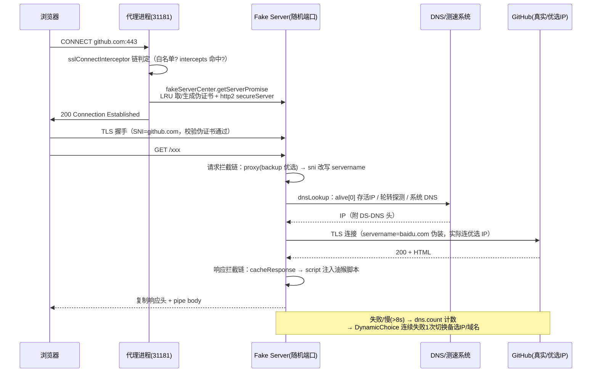

# dev-sidecar 架构文档

> 基于 [docmirror/dev-sidecar](https://github.com/docmirror/dev-sidecar) 源码（v2.2.1）分析整理。
> 文中 `packages/xxx/src/...:行号` 均相对仓库根目录，可直接跳转。

---

## 1. 项目概述

**dev-sidecar（开发者边车）** 是一款面向开发者的本地 HTTPS 代理加速工具，命名借鉴 service-mesh 的 sidecar 模式。它通过在本机运行一个 MITM（中间人）HTTPS 代理，对 GitHub、Stack Overflow、npm、Docker Hub 等境外站点的请求做**DNS 优选、SNI 伪装、请求拦截/重定向、镜像替换、脚本注入**，从而解决国内开发者访问这些站点慢或失败的问题。

核心能力：

| 能力 | 说明 |
|---|---|
| DNS 优选 | 多 provider（UDP/TCP/DoH/DoT/预设 IP）解析 + TCP 测速，自动挑选最快可用 IP，对抗 DNS 污染 |
| 请求拦截 | 按域名+路径正则匹配，执行重定向、镜像代理、SNI 改写、缓存、脚本注入等动作 |
| GitHub 加速 | SNI 伪装直连（思路来自 fastGithub）、release/clone/raw 加速（油猴脚本 + 镜像重定向） |
| 镜像切换 | npm registry（淘宝/中科大）、PyPI 镜像、Electron/SASS/Chromedriver 等二进制镜像一键切换 |
| 系统代理 | 自动设置/恢复操作系统级 HTTP 代理，支持国内域名直连分流（PAC 白名单） |
| 插件化 | git/node/pip/overwall/free-eye（护眼）等插件，统一生命周期管理 |

**三种运行模式**（README 定义）：安全模式（仅 DNS 优选+测速，不装证书、不拦截）、默认模式（拦截+远程配置）、增强模式（额外启用 overwall 分流）。

**技术栈**：Node.js 22.x / Electron 41 / Vue 3 + Ant Design Vue 4 / pnpm workspace monorepo / node-forge（证书）/ log4js；Windows 原生能力靠 `@starknt/sysproxy`、`winreg`、`node-powershell`；CLI 支持 Node.js SEA 打包为单可执行文件。许可证 MPL-2.0。

---

## 2. 总体架构

### 2.1 Monorepo 包结构

pnpm workspace（`shamefullyHoist: true`），四个 JS 包 + 一个 Linux 打包辅助目录：

```
packages/
├── core/        @docmirror/dev-sidecar        编排层：配置、插件、系统代理、子进程管理
├── mitmproxy/   @docmirror/mitmproxy          代理引擎：MITM/拦截器/DNS/测速（作为子进程运行）
├── gui/         @docmirror/dev-sidecar-gui    Electron + Vue3 桌面应用
├── cli/         @docmirror/dev-sidecar-cli    无头命令行版（支持 SEA 单文件）
└── aur/         Arch Linux PKGBUILD（非 JS 包）
```

包依赖关系（**注意 mitmproxy 反向依赖 core**，用于 JSON5 解析与日志工具）：

```
        gui ──────────────┐
                          ▼
        cli ──────> core (@docmirror/dev-sidecar)
                          ▲   │
                          │   │ fork 子进程（传 running.json 路径）
        （依赖 core 工具） │   ▼
        mitmproxy <───────┘  mitmproxy (@docmirror/mitmproxy)
```

### 2.2 进程模型

运行时共两层进程，GUI 版与 CLI 版互斥（同一时刻只能运行一个实例）：

```
┌─────────────────────────────┐        ┌─────────────────────────────┐
│  GUI 宿主（Electron 主进程）  │   或   │  CLI 守护进程（ds-cli start） │
│  src/background.js          │        │  cli/src/index.js --daemon   │
│  · 窗口/托盘/IPC 桥          │        │  · 文件锁/配置/信号处理        │
└──────────────┬──────────────┘        └──────────────┬──────────────┘
               │ child_process.fork(mitmproxyPath,    │
               │   ['~/.dev-sidecar/running.json'])   │
               ▼                                      ▼
┌─────────────────────────────────────────────────────────────────┐
│  代理引擎子进程 @docmirror/mitmproxy                              │
│  · HTTP 代理服务  127.0.0.1:31180（port-1）                       │
│  · HTTPS 代理服务 127.0.0.1:31181（port）                         │
│  · 证书体系 / 拦截器管道 / DNS / 测速 / 流量监控                    │
└─────────────────────────────────────────────────────────────────┘
               ▲ IPC 消息（status / error / speed / traffic / action）
```

- 互斥：GUI（`background.js` 中 `app.requestSingleInstanceLock()` + core 的 `proper-lockfile` 文件锁 `~/.dev-sidecar/dev-sidecar.lock`）与 CLI（同一把文件锁）互斥，实例信息写入 `running.json` 的 `app.instance`。
- 父→子 IPC：`{type:'action', event:{key:'close'}}` 关闭、`{type:'speed'}` 测速控制（`packages/core/src/modules/server/index.js:125` 附近）。
- 子→父 IPC：`{type:'status'|'error'}` 状态上报、`{type:'traffic', key:'stats'}` 流量（每 2 秒）、`{type:'speed'}` 测速结果；父进程将其转发到 core 事件总线。

### 2.3 端到端数据流总览

```
浏览器/应用 ──系统代理──► mitmproxy 子进程（31180/31181）
                          │ DNS 优选（DoH/DoT/预设IP + TCP 测速）
                          │ TLS：本地 CA 动态签发伪证书 → MITM 解密
                          │ 拦截器管道：SNI 改写 / 镜像代理 / 重定向 / 缓存 / 脚本注入
                          ▼
                    目标站点 / 镜像站 / 中转服务器(overwall)
```

---

## 3. core 包（编排层，`packages/core`）

入口 `packages/core/index.js` → `src/expose.js`。对外暴露统一 API 树（`src/expose.js:161-177`）：

```
DevSidecar.api = { startup, shutdown, status, config, event, shell, server, proxy, plugin, instance, log }
```

### 3.1 启动 / 停止流程

`startup({ mitmPath, setting })`（`src/expose.js:64-113`）将**服务、系统代理、全部插件三组任务并行启动**（注释明确：服务未监听瞬间的请求失败属计划内行为）：

1. `server.start()` —— 条件 `config.server.enabled && !status.server.enabled`（幂等，靠状态树判断）；
2. `proxy.start()` —— 设置 OS 系统代理指向 `127.0.0.1:31181`；
3. 逐个插件 `.start()` —— 条件 `config.plugin[key].enabled`；特殊拦截：`overwall` 插件必须 `setting.json` 中 `overwall === true` 才允许启动（强制用户确认过风险，`expose.js:91-94`）。

`shutdown()`（`expose.js:115-159`）反向执行：先并行关闭插件（清理 git/npm 配置）与系统代理，最后关闭 server 子进程。

`server.start()` 的完整职责（`src/modules/server/index.js`）：

1. 防重入（已有存活子进程直接返回）；
2. **合成运行时配置**：深拷贝 `config.server`，把所有启用插件的 `intercepts`/`dns` 映射合并进去，逐个调用插件 `overrideRunningConfig(serverConfig)` 钩子；
3. **写 `~/.dev-sidecar/running.json`**（保留已有 `app.instance`，避免覆盖实例信息）；
4. `fork(mitmproxyPath, [running.json 绝对路径])` —— 子进程唯一参数即配置文件路径（`server/index.js:120`）；
5. 订阅子进程 IPC 消息转发到事件总线；提供 `kill()`（SIGINT → 1 秒后 SIGKILL）与 `restart()`。

### 3.2 配置系统（core 最复杂的子系统）

**五层合并**（`src/config/local-config-loader.js:90-111`），按优先级从低到高：

```
默认配置(src/config/index.js，约 470 行)
  └─ 共享远程配置(remote_config.json5，从 gitee/GitHub 下载落盘)
      └─ 个人远程配置(remote_config_personal.json5)
          └─ 用户配置(~/.dev-sidecar/config.json，只存 diff)
```

加载顺序上做了**两次合并**：先让远程配置排在前面控制对象键顺序（GUI 展示顺序），用默认配置补全后再合并一次使远程值生效，最后用户配置覆盖一切。

- **合并策略**（`src/merge.js`）：`lodash.mergeWith` 深合并，**数组整体替换**（不按下标合并）。
- **diff 保存**（`src/config-api.js:147-181`）：保存时把新配置与「默认+远程」做 `doDiff`（旧有新无的键记为 `null`），**只把差异写进 config.json**；`deleteNullItems` 同时识别 `'[delete]'` 标记实现"删除"语义。
- **远程配置自动更新**（`config-api.js:19-142`）：启动即下载，之后每 24h 定时下载并 reload；请求显式 `proxy:null`（防止环境变量代理指向自己造成死循环），对 `raw.githubusercontent.com` 注入 `Server-Name: baidu.com` 头。仓库内置兜底模板 `src/config/remote_config.json5`。
- **默认配置内容**（`src/config/index.js`）：`server.intercepts`（核心拦截规则表，约 175 行）、`server.preSetIpList`（域名→IP 预设）、`server.whiteList`（`*.cn` 等直连白名单）、`server.dns`（providers + mapping）、`server.compatible`、`cloudflareRoute` 等；`proxy`/`plugin` 两棵子树在装配期由各模块/插件通过 `config.addDefault()` 注入。

### 3.3 事件总线与状态树

- **event**（`src/event.js`）：41 行的同步事件总线，`register(channel, handle, order)` 按 order 升序执行，`fire(channel, event)` 顺序同步调用。频道：`status`、`error`、`speed`、`traffic`。
- **status**（`src/status.js`）：一个普通对象 `{server:{}, proxy:{}, plugin:{}}`，模块加载即注册 order=-999 的首个 handler —— **状态树是事件流的投影**：`event.fire('status',{key:'proxy.enabled',value:true})` → `status.proxy.enabled = true`。startup/shutdown 都以它做幂等判断。
- **instance 模块**（`src/modules/instance/index.js`）：订阅 status 事件，把所有 `*.enabled` 键以 300ms 防抖写入 `running.json` 的 `app.status`，供 `ds-cli status` 等外部进程读取。

### 3.4 插件系统

统一装配模式（`expose.js:18-28`）：每个插件是模块对象 `{ key, config, status?, plugin: 工厂函数 }`，工厂函数接收 `context = {config, event, shell, log}` 返回 api 对象。约定方法：`start()/close()/restart()/save(newConfig)`，可选 `isEnabled()/run()/overrideRunningConfig(serverConfig)`。不可用插件（如 SEA 环境加载不了 free-eye）自动注册 stub（`expose.js:35-51`）。

| 插件 | 作用 | 关键机制 |
|---|---|---|
| **git** | git 命令行加速 | 写全局 gitconfig：`http.proxy=127.0.0.1:31180`、`https.proxy=127.0.0.1:31181`；可选关闭 sslVerify（MITM 证书不被 git 信任）；gitee/coding/Codeup 走 noProxy 直连。实际加速能力来自 server 端拦截规则（SNI 伪装 + preSetIpList） |
| **node** | npm/yarn 加速 | `npm config set proxy/https-proxy/registry`；写系统环境变量 `ELECTRON_MIRROR`、`SASS_BINARY_SITE`、`NODE_EXTRA_CA_CERTS` 等全套二进制镜像变量（npm 11 不再接受未知 config，改为直接写环境变量）；清理旧版写入 `.npmrc` 的残留 |
| **pip** | PyPI 镜像 | `pip config set global.index-url`（内置 10 个国内镜像），`enabled:null` 表示总是执行，无开关 |
| **overwall** | 增强分流（代理被墙站点） | 内置默认中转服务器 + 用户自定义服务器；30+ 域名 targets；从 gfwlist 下载/更新 pac.txt 做分流判定。实际转发在 mitmproxy 侧中间件完成（见 4.6）。受 `setting.json` 双开关保护 |
| **free-eye** | 护眼模式 | ESM 插件（其余为 CJS），检测 DNS/路由/TCP/TLS 四个 checkpoint 判断网络环境，向浏览器注入护眼脚本 |
| **proxy**（特殊插件） | 系统代理管理 | 调 shell 设置 OS 代理；`excludeIpList`（国内大厂 + 局域网）排除直连；可选写 `HTTPS_PROXY` 环境变量与 `REQUEST_CA_BUNDLE`；Windows 下 `EnableLoopback.exe` 解除 UWP 应用回环限制 |

### 3.5 shell 模块（OS 抽象层，`src/shell/`）

跨平台系统操作封装：

- **系统代理**：Windows 用 `@starknt/sysproxy` 原生模块 / `sysproxy.exe`；macOS `networksetup`；Linux `gsettings`。退出/关机时恢复原值（备份于 `proxy-env-backup.json`）。
- **根证书安装**：Windows certutil / PowerShell 导入，macOS security 工具 + `sudo-prompt` 提权，Linux 各发行版 ca-certificates 路径。
- **辅助脚本**（`src/shell/scripts/`）：`kill-by-port.js` 按端口杀进程、`enable-loopback.js`（UWP 回环）、`get/set-system-env.js` 读写注册表环境变量（winreg）。

---

## 4. mitmproxy 包（代理引擎，`packages/mitmproxy`）

> 名字里的 "mitmproxy" 指 Node 实现的 MITM 代理包，与 Python 的 mitmproxy 无关。以子进程运行，唯一输入是 `running.json`。

### 4.1 服务器创建（`src/lib/proxy/mitmproxy/index.js`）

`createProxy()` 流程：初始化 CA → 可选启动测速 → 用 `createRequestHandler` 包装统一请求处理器 → **同时创建两个 `http.Server`**：HTTPS 端口 = 配置 port（默认 31181），HTTP 端口 = port-1（31180）（`index.js:152-159`）→ 启动流量监控与进程归属解析。这也解释了各插件配置中 http 代理写 `port-1`、https 代理写 `port` 的原因。

### 4.2 MITM 原理与证书体系

```
TLS 握手链路：
浏览器 ──CONNECT──► 代理(31181) ──判定需 MITM──► 本地 fake server（随机端口）
                    │                            │ SNICallback 对任意 SNI 返回同一伪证书
                    │ 200 Established            │ 伪证书 = 本地 CA(自签 RSA2048, 20年) 签发的
                    ▼                            │          按域名生成的 RSA2048 证书(1年)
                    浏览器校验伪证书（须先信任本地 CA）──TLS──► fake server ──TLS──► 真实站点
```

- **CA 生成**（`src/lib/proxy/tls/tlsUtils.js`）：首次运行用 node-forge 生成自签 CA（CN=`DevSidecar - This certificate is generated locally`），持久化到 `~/.dev-sidecar/dev-sidecar.ca.crt` 与 `.key.pem`。
- **伪证书按域名生成**：`createFakeCertificateByDomain` 用 Node 原生 `crypto.generateKeyPair`（libuv 线程池异步，避免 forge 同步阻塞），SAN 为通配域名集；`CertAndKeyContainer` 以 LRU（256）缓存证书 Promise，同一通配域名只生成一次。
- **FakeServersCenter**（`tls/FakeServersCenter.js`）：LRU 缓存（默认 256）本地 fake server，key 为 `域名:端口:ssl`。fake server 是 **`http2.createSecureServer({allowHTTP1:true})`**（兼容 HTTP/1.1），`SNICallback` 固定返回同一 secureContext；HTTP/2 的 `:authority` 伪头回填为 `req.headers.host`。`listen(0)` 随机端口。
- **自动端口兼容**：非 443/80 端口遇到 `ERR_SSL_*` / `HPE_INVALID_METHOD` 客户端错误时自动纠正该域名的 ssl 判定，并持久化到 `~/.dev-sidecar/automaticCompatibleConfig.json`（`proxy/compatible/compatible.js`）。
- **直连隧道**：白名单或未命中拦截规则的 CONNECT 不做 MITM，直接 `net.connect` 双向 pipe（可注入自定义 DNS lookup）；连接失败计数回写 DNS 用于优选。

### 4.3 请求处理管道（`src/lib/proxy/mitmproxy/createRequestHandler.js`，约 670 行核心）

执行模型：请求拦截器链返回 `truthy` = 拦截器终结请求、`falsy` = 放行给下一个；响应拦截器返回 `{head, body}` 片段累加注入、`false` 中断。域名匹配（`utils/util.match.js`）支持精确/`*.host`/正则，多命中按「精确 > `*.host` > `*host` > 正则」合并，正则捕获组可用于 `${p[1]}`、`${h[1]}` 占位符替换。匹配结果 LRU 缓存（512）。

**请求侧拦截器**（按 priority 升序，`src/lib/interceptor/impl/req/`）：

| pri | 名称 | 行为 |
|---|---|---|
| 100 | retry | 声明重试策略（默认 GET/HEAD、500 状态码），真正重试在主循环，`DS-Retry` 头标注次数；≤1MB 的请求体缓存以支持重放 |
| 101 | OPTIONS | 预检请求直接回 200 + 全套 CORS 头（Max-Age 30 天），终结 |
| 102 | success | 回固定 200/自定义响应，终结 |
| 103 | abort | 回 403/自定义响应，终结 |
| 104 | cacheRequest | GET 请求若 `now-If-Modified-Since < maxAge` 直接回 304 |
| 105 | redirect | 302 + Location 重定向（如 release 下载 → ghproxy 镜像） |
| 111 | requestReplace | 改写/删除请求头（`'[remove]'` 语义），不终结 |
| 121 | **proxy** | **核心转发拦截器**：改写 rOptions 的 protocol/hostname/port/path/host（支持占位符替换）；配置 `backup` 备选列表时接入 DynamicChoice 优选 |
| 123 | sni | SNI 伪装：替换 `servername`（github.com → sni:'baidu.com' 是默认规则之一）；空值则不发送 SNI |
| 124 | unVerifySsl | 切换 `rejectUnauthorized:false` 的 agent（verify/noverify 双 agent 成对按参数缓存） |
| 131 | baiduOcr | 请求 query 当图片 base64，轮询百度云 OCR 账号识别（特殊场景功能） |

**响应侧拦截器**（`impl/res/`）：

| pri | 名称 | 行为 |
|---|---|---|
| 201 | AfterOPTIONSHeaders | 为正常请求补 CORS 响应头（直改 rawHeaders） |
| 202 | cacheResponse | 改写 `cache-control/last-modified/expires`，与 cacheRequest 的 304 判定形成完整浏览器缓存链 |
| 203 | responseReplace | 替换/新增/删除响应头；`doDownload` 时强制 `content-disposition: attachment` |
| 211 | script | HTML 页面注入 `<script>` 标签（内置油猴脚本目录），从 CSP 提取 nonce 通过 strict-dynamic；返回注入片段 |

**主流程**（`createRequestHandler.js:453-574`）：请求拦截链 → 重试循环执行 `proxyRequestPromise`（DNS 优选解析 → keepalive agent → 发真实请求）→ 响应拦截链 → `InsertScriptMiddleware` 做 HTML head 注入 → 复制响应头（过滤 HTTP/2 禁止头）→ `proxyRes.pipe(res)`。错误时按 Accept 内容协商返回 HTML/JSON/文本错误页。

**诊断响应头**：`DS-DNS`（实际使用的 DNS 与 IP）、`DS-Proxy-Request*`、`DS-Retry`、`DS-Interceptor`、`DS-Overwall` 等，便于排查加速是否生效。

### 4.4 DNS 系统（`src/lib/dns/`）

多 provider 统一抽象（`base.js` 每 provider 一个 LRU 缓存 1024）：

| 类型 | 实现 | 说明 |
|---|---|---|
| UDP/TCP | `udp.js`/`tcp.js` | dns-packet 报文，5s 超时 |
| DoH | `https.js` | 走 keepalive agent，**可借道外部代理**；配了 sni 时 `rejectUnauthorized:false` |
| DoT | `tls.js` | 853 端口，内置 dns-over-tls 精简实现 |
| PreSet | `preset.js` | 不查询，直接返回 `preSetIpList` 预设 IP（对抗污染的兜底） |
| ForSNI | 标记 provider | 供 SNI 伪装场景专用解析（servername ≠ hostname 时 TLS 校验依赖它） |

选择优先级：`preSetIpList` 命中 → PreSet；`dns.mapping` 命中 → 对应 provider；否则系统 DNS。

`dnsLookup`（`proxy/mitmproxy/dnsLookup.js`）挂到每个请求的 lookup 上：① 测速存活 IP 直接用（`pickFastAliveIpObj`）→ ② 无存活则轮转分配未失败 IP 分散探测（`pickNextForProbing`）→ ③ 回落系统 DNS。另有两处防护：**Cloudflare IP 优选重写**（`cloudflareRoute.js`，从 CF API 拉网段每小时刷新，命中 CF 段的 IP 重写为用户优选 IP）；**全零 IP 标记**（0.0.0.0 是 Adblock 拦截特征，标记到流量监控）。IPv6 在无公网网卡或累计 3 次 `ENETUNREACH` 后自动禁用。

### 4.5 测速系统（`src/lib/speed/`）

- `SpeedTester` 按域名懒创建；`test()` 并发向多个 DNS provider 解析合并候选 IP，然后**并发 TCP 连接测速**（5s 超时，连接耗时即延迟；PING 方案已弃用），存活 IP 按耗时升序存入 `alive`。
- 周期复测（`config.interval`），60 分钟无访问自动停表；真实请求的成败通过 `dns.count()` 回写，驱动坏 IP 降权。
- 结果双消费：dnsLookup 优先取 `alive[0]`；GUI 订阅 `speed` 事件展示测速列表。

### 4.6 动态故障切换（`src/lib/choice/`，`DynamicChoice`）

`proxy` 拦截器对配置了 `backup` 的域名创建 `DynamicChoice`（LRU 1024 单例池）。算法（`choice/index.js:105-132`，已核对源码）：

- 初始成功率 50%，按列表位置递减 total 形成初始权重；`value = 列表首项`。
- **当前后端连续失败 1 次立即切换**（源码注释：坏 IP 不值得等 3×15s），或成功率 < 0.4 切换；成功清零连续失败计数。
- 备选耗尽时按成功率重排名（`doRank`）重建列表；全部失效则回落原配置。

### 4.7 上游代理与 overwall 中间件

- **外部代理支持**（`proxy/common/util.js`）：`externalProxy` 配置（字符串或函数）时，按「请求协议 × 代理协议」组合选择 `tunnel-agent`（httpsOverHttp / httpsOverHttps / httpOverHttps）或改写路径直发；DoH 查询也因此可走外部代理。
- **overwall 中间件**（`proxy/middleware/overwall.js`）：core 侧 overwall 插件的执行端。`sslConnectInterceptor` 用 targets 配置 + pacClient（gfwlist 规则）判定命中；命中后把请求**改写为中转服务器 URL**（`https://中转域/路径/真实域名/原始路径`），由中转服务器代为访问目标站点（而非 SOCKS/CONNECT 隧道）。`DS-Overwall` 头标注来源。响应侧 `source/pac.js` 提供本机 PAC 文件下载端点。

### 4.8 流量监控与进程归属（`src/lib/traffic/`）

- `TrafficMonitor`：在请求/连接入口 attach，按域名/进程累计上下行流量，每 2 秒经 IPC 上报父进程，最终推到 GUI 流量页。
- `processResolver`：维护「代理端口 ↔ 客户端端口 ↔ 进程 PID」映射（Windows 用 netstat 解析），把每条连接归属到具体进程名。

---

## 5. gui 包（Electron 桌面应用，`packages/gui`）

### 5.1 主进程启动（`src/background.js`）

```
模块加载: 预读日志配置 → app.setName → Chromium 降耗开关（renderer-process-limit=1、
         use-system-ca、禁 GPU 光栅化等）→ config.reload()
app.ready:
  ① core 实例锁 acquireLock（失败退出）→ writeInstance({type:'gui'}) 写 running.json
  ② Windows 关机钩子（@starknt/shutdown-handler-napi，保证关机前有时间恢复系统代理）
  ③ createWindow 900x750（F12/F5 等快捷键、closeStrategy 关闭策略）
  ④ backend.install(context) 安装 IPC 桥
  ⑤ setTray 托盘（左键唤窗、右键菜单）
  ⑥ powerMonitor shutdown 事件 → quit() → api.shutdown() 恢复系统代理
```

单实例锁双层：Electron `requestSingleInstanceLock` + core `proper-lockfile` 文件锁。崩溃处理全程 try/catch + `dialog.showErrorBox`；core 侧还挂了 `uncaughtException/unhandledRejection` 兜底。

### 5.2 IPC 动态 RPC 桥（最巧妙的设计，`src/bridge/api/backend.js`）

渲染层无需逐个注册 API：

1. **主进程**：`getApiList()` 深度遍历 `DevSidecar.api + localApi` 收集全部函数「点路径」（如 `server.start`、`config.save`、`plugin.git.start`）；`ipcMain.handle('apiInvoke', [apiPath, param])` 按 `lodash.get` 路径查找并调用（`backend.js:233-265`）。
2. **渲染进程**（`src/view/api.js`）：启动时 `invoke('getApiList')`，为每个路径生成代理函数挂到 `$api` 树 —— 页面直接 `this.$api.server.start()`。
3. **事件推回**：主进程把 core 事件总线四个频道桥接到窗口：`status`（Vue reactive 状态树）、`error`（EADDRINUSE 等弹窗处理）、`speed`（测速页）、`traffic`（流量页）。
4. 本地 API 覆盖：`config.save/update/reload` 成功后广播 `config.changed`；`startup/server.start` 调用时自动注入 `mitmproxyPath`（指向 asar 外的 `src/bridge/mitmproxy.js`）与 `setting`。

### 5.3 页面与设置

路由（hash 模式）：`/index` 总开关仪表盘（含 CA 安装引导、安全/默认/增强模式切换）、`/server` 加速服务（DNS 分流、测速、白名单）、`/proxy` 系统代理（excludeIpList、EnableLoopback）、`/traffic` 进程/域名流量、`/setting`、`/help`、`/github-status`、五个插件页（`/plugin/git|node|pip|free-eye|overwall`）。设置双层持久化：主配置走 core 的 `config.json`（diff 存储）；软件设置 `setting.json`（rootCa.setuped、overwall 解锁开关等）由 GUI 直接读写。暗色主题用 antd darkAlgorithm 三态切换。

### 5.4 打包与增量更新（`electron-builder.config.cjs` + `pkg/`）

- Windows NSIS（x64/ia32/arm64，未签名）、macOS dmg+zip、Linux deb/AppImage/rpm/flatpak。
- `asarUnpack: ['src/bridge/mitmproxy.js']` —— 子进程脚本必须在 asar 外才能 fork。
- `after-pack`：裁剪 Electron 语言包只留 zh-CN（省 15-20MB）、生成**增量更新包** `update-{platform}-{arch}-{version}.zip`；`after-all-artifact-build` 向 `latest.yml` 追加 partPackage 元数据。
- 增量更新流程（`bridge/update/backend.js`）：匹配 GitHub Releases 资产 → 下载（CA 列表包含自签根证书）→ 退出前 `app.relaunch` + AdmZip 解压覆盖 resources 目录。

---

## 6. cli 包（无头版，`packages/cli`）

- `ds-cli start`：端口占用检查 → `fork(index.js, ['--daemon'], {detached})` 后台化 → 写 PID 文件。
- 守护进程（`src/index.js`）：`DEV_SIDECAR_LOG_TO_CONSOLE=false`（命令输出与日志分离）→ 文件锁 → `api.startup()` → 远程配置定时下载；SIGINT/SIGTERM → `api.shutdown()` 清理。
- 命令集：`start/stop/restart/status`（读 running.json 的 `app.status`）、`proxy on|off`、`plugin start|stop <name>`（fork worker 执行并持久化 enabled 到 config.json）、`service install`（systemd/launchd/注册表 Run 键）、`--gui` 跨平台控制 GUI。
- **SEA 单文件打包**（`scripts/build.js`）：esbuild 打包 `sea-entry.js` → Node 24 SEA blob → postject 注入 Node 二进制，产出免安装 `ds-cli-{ver}-{platform}`；SEA 模式不走 core 的 server/proxy 模块，同进程直启 mitmproxy 并手动同步状态。

---

## 7. 端到端关键时序：一次 HTTPS 加速请求

以浏览器访问 `https://github.com/xxx`（默认模式，已信任根证书）为例：



---

## 8. 磁盘文件布局（`~/.dev-sidecar/`）

| 文件 | 用途 |
|---|---|
| `config.json(.json5)` | 用户配置（只存与默认/远程的差异 diff） |
| `remote_config.json5` / `remote_config_personal.json5` | 远程共享/个人配置落盘（24h 自动更新） |
| `running.json` | 运行时配置快照（子进程唯一输入）+ `app.instance` 实例信息 + `app.status` 状态镜像（300ms 防抖） |
| `dev-sidecar.lock` | proper-lockfile 实例互斥锁（GUI/CLI 互斥） |
| `dev-sidecar.ca.crt` / `.key.pem` | 本地生成的根证书/私钥 |
| `setting.json` | GUI 软件设置（rootCa.setuped、overwall 解锁、installTime） |
| `automaticCompatibleConfig.json` | 非标端口 ssl 判定自动纠正的持久化 |
| `pac.txt` / `domestic-domain-allowlist.txt` | overwall 分流规则 / 国内直连域名白名单 |
| `proxy-env-backup.json` | 系统代理/环境变量原值备份（退出恢复） |
| `logs/core.log`、`gui.log`、`server.log` | log4js 分包日志（`DEV_SIDECAR_LOG_TO_CONSOLE=false` 可关 stdout） |

---

## 9. 关键设计决策与亮点

1. **子进程隔离代理引擎**：MITM 引擎 fork 隔离运行，崩溃不拖垮宿主；配置经 running.json 文件传递，父父子进程仅靠少量 IPC 消息通信，职责边界干净。
2. **配置即规则**：所有加速行为（拦截、DNS、预设 IP、插件配置）都是声明式配置树；远程配置 24h 自动更新使规则库免发版热更新；用户配置只存 diff、支持 `null`/`'[delete]'` 删除语义。
3. **事件投影状态**：status 树是 `status` 事件流的投影（order=-999 的首个 handler），启动幂等判断、GUI 状态展示、CLI status 命令三端共用同一数据源。
4. **多层动态优选**：DNS 多 provider → TCP 测速 → 存活 IP 池 → 真实请求成败回写 → DynamicChoice 连续失败 1 次即切换备选 —— 形成从解析到请求的闭环自愈。
5. **动态 RPC 桥**：主进程反射式收集 API 树、渲染层按路径生成代理函数，新增 API 零样板代码。
6. **渐进式信任模型**：安全模式不装证书不 MITM；增强模式需在 setting.json 显式解锁 overwall（双重开关），风险分级。
7. **模块系统混用约定**：core/mitmproxy/cli 为 CommonJS，gui 为 ESM（`"type":"module"`）；共享 JSON5 解析器统一走 `@docmirror/mitmproxy/src/json`。
8. **webpack 陷阱记录**：`gui/vue.config.cjs` 强制 `concatenateModules:false` —— 模块拼接会破坏 ant-design-vue 基于 Symbol 的 provide/inject，导致菜单崩溃/暗色失效（升级 webpack 时勿删）。

---

## 10. 构建环境与常用命令

**环境要求**：Node.js 22.x、Python 3.11（uv 管理，原生模块编译用）、VS 2022 C++ 桌面开发工作负载（Windows）；`.npmrc` 设 `CXXFLAGS=-std=c++17`。

```bash
pnpm install                                # 依赖安装（必须 pnpm，workspace + shamefully-hoist）
pnpm lint                                   # 全仓库 ESLint（@antfu 配置）
pnpm --filter @docmirror/dev-sidecar test   # core 测试（mocha + chai）
pnpm --filter @docmirror/mitmproxy test     # mitmproxy 测试

# GUI 开发
cd packages/gui
npm run electron        # 开发模式（Vue dev server 8080 + Electron）
npm run electron:build  # 生产构建（vue build + electron-builder）
```

---

## 附录：源码目录速查

```
packages/core/src/
├── index.js / expose.js        入口与 API 装配、startup/shutdown
├── config/index.js             默认配置（拦截规则、DNS、预设 IP）
├── config-api.js               配置读写/diff 保存/远程配置下载
├── merge.js / event.js / status.js   深合并 / 事件总线 / 状态投影
├── modules/server/index.js     mitmproxy 子进程生命周期 + running.json
├── modules/proxy/index.js      系统代理（proxy 插件形态）
├── modules/plugin/{git,node,pip,overwall,free-eye}/
├── modules/instance/index.js   实例锁 + 状态镜像
└── shell/                      OS 抽象（系统代理/证书/环境变量/杀端口）

packages/mitmproxy/src/
├── index.js                    子进程入口（api.start/close/reSpeedTest）
├── options.js                  配置标准化 + 拦截器编译（createIntercepts）
├── lib/proxy/mitmproxy/        双端口服务器 / CONNECT 处理 / 请求处理器 / fake server 中心
├── lib/proxy/tls/              CA 与伪证书（tlsUtils/FakeServersCenter/CertAndKeyContainer）
├── lib/interceptor/impl/{req,res}/   全部拦截器实现（见 §4.3 表格）
├── lib/dns/                    UDP/TCP/DoH/DoT/PreSet provider + base 缓存
├── lib/speed/                  TCP 测速（SpeedTester）
├── lib/choice/                 DynamicChoice 故障切换
├── lib/proxy/middleware/       InsertScriptMiddleware / overwall / pac
├── lib/traffic/                流量监控 + 进程归属
└── lib/proxy/common/           keepalive/tunnel agent + 超时配置

packages/gui/src/
├── background.js               Electron 主进程
├── bridge/api/backend.js       动态 RPC 桥（apiInvoke + 事件转发）
├── bridge/mitmproxy.js         子进程入口脚本（asar 外）
├── bridge/update/backend.js    增量更新
└── view/                       Vue 页面（router/pages/mixins/theme）

packages/cli/src/
├── index.js                    守护进程 + 命令路由
├── commands/                   start/stop/status/plugin/proxy/service/gui
├── mitmproxy.js                子进程入口脚本
└── sea-entry.js                SEA 单文件入口（同进程直启）
```
